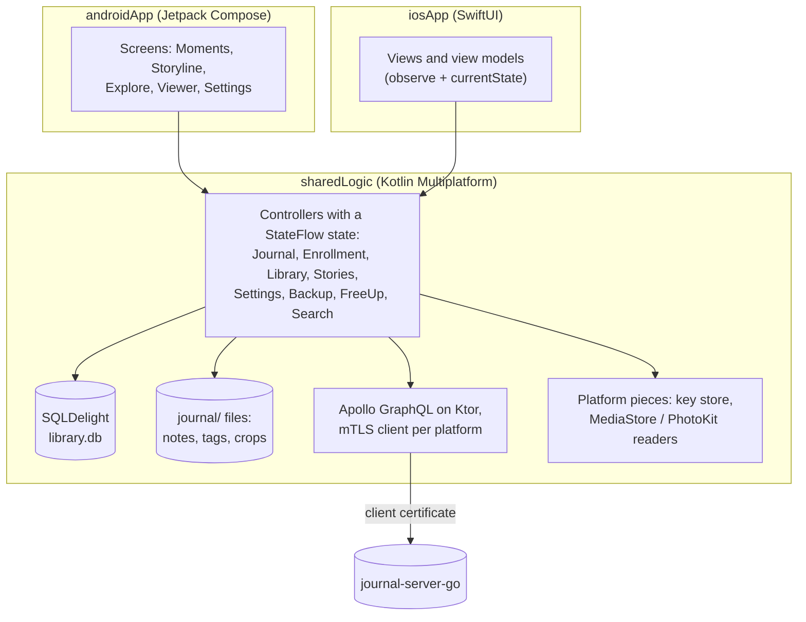

# Journal (Android and iOS)

A private photo journal for Android and iOS, backed by your own server
([journal-server-go](https://github.com/chencohensolutions/journal-server-go)). Like Google Photos or iCloud
Photos, it backs up everything you shoot and lets you keep originals only on the server. Unlike them, it is a
journal: you write a title and a paragraph on the photos that matter, and those become your **storyline**.
Everything else arranges itself into **moments**.

Built with **Kotlin Multiplatform**. All the logic is shared and tested once, and each platform has its own native UI
(Jetpack Compose on Android, SwiftUI on iOS).

## Features

- **Moments.** Every photo and video in one feed, full width at its own shape. The feed is split by day (or by breaks
  between photos), place and source. Near-duplicates collapse into one set you swipe through. A month pill and a
  timeline let you jump to any date.
- **Storyline.** Every photo you've written on, newest first. Each save keeps the earlier version, and History shows
  what changed, with Restore.
- **Explore.** Towns by country, years, a map (MapLibre with OpenFreeMap tiles), and **People**: the faces the server
  recognized, with "Who's this?" to name them.
- **Search.** Text search across the library ("dog on the beach"), by person, and by text in photos. With
  **on-device search**, the phone keeps the server's indexes and runs the SigLIP text model on ONNX Runtime itself,
  so search works offline.
- **Sets by looks.** Photos that look alike form one set, however far apart they were taken. This combines a dHash
  for near-duplicates with each platform's own image embedding: Vision feature prints on iOS, MediaPipe
  MobileNet-V3 on Android. You can merge and split sets by hand.
- **Backup.** Automatic background backup over mTLS: WorkManager on Android, background tasks on iOS. Uploads are
  resumable, and on Android backup can be limited to chosen Wi-Fi networks or to charging.
- **Free up space.** Takes the originals the server already has off the phone, by age or by size. Before anything
  goes to the phone's trash, both sides hash their copy again and must match. Server-only photos then load as
  exact-size previews, and videos stream with HTTP Range into a byte-range cache.
- **Privacy.**
  - **Private photos** are hidden on every device until you choose to show them.
  - **Hidden collections**, behind the phone's lock, hide WhatsApp, chosen apps' screenshots, calls and recordings,
    or what the nudity scan flags. The server does the hiding, so nothing leaks through another device.
- **Sound.** Phone calls, recordings and voice messages, on their own page and in Moments, with a player.
- **Never touches your photo library.** The app only reads MediaStore and PhotoKit. `PhotoSafetyTest` fails the
  build if any source uses a MediaStore/PhotoKit write API or asks for a write permission.
- **Hebrew and English**, including right-to-left layouts.

## Architecture



- **Logic lives in `sharedLogic`, with tests.** Each controller exposes one `StateFlow` state, and the UIs only
  render it and call controller methods.
  - `JournalController`: the connection.
  - `EnrollmentController`: registering the device.
  - `LibraryController`: the merged phone and server library, kept in SQLDelight.
  - `StoriesController`: notes, tags, crops and sets, the storyline and the Moments feed.
  - `SettingsController`, `BackupController`, `FreeUpController`, `SearchController`: their own screens.
- **Platform code is small and explicit.** The platform folders hold the mTLS clients (OkHttp, and URLSession
  through Ktor's Darwin engine), the key stores (Android Keystore/StrongBox, iOS Secure Enclave), the photo readers
  and the background schedulers. `AndroidJournal.kt` and `IosJournal.kt` wire them up.
- **Plain files for what you write.** Notes are versioned JSON files (written to a temp file and renamed) in the
  app's private storage, and a damaged file never hides the others. The library database is a cache that can always
  be rebuilt from MediaStore/PhotoKit and the server's change feed.
- **The server decides visibility.** Hidden and private files come through the change feed as deleted, so every
  device agrees, and the app drops their cached previews, originals and videos.

## Security

Every request is authenticated by a client certificate (mutual TLS). The certificate's Common Name maps to a user
on the server.

**Enrollment.** On first launch the app asks for the server address and a one-time code from
`journal-server enroll-code <user>`. You can also scan the QR code that command prints, or open a
`journal://enroll?code=…&server=…` link. The app then:
1. creates an EC P-256 key in secure hardware (StrongBox or Keystore on Android, the Secure Enclave on iOS),
2. sends a certificate request,
3. stores the certificate the server signs.

The private key never leaves the device. Certificates renew themselves in their last 30 days.

Each server has its own CA, made when it is set up. Scanning the QR code tells the app the server's key, and once
enrolled the app keeps the server's CA (`serverInfo.caCertificate`), so it trusts that server by it from then on.
The CA of the first servers is also compiled into the app ([server-ca.pem](sharedLogic/src/commonMain/certs/server-ca.pem)),
so phones enrolled there keep working, and a code typed by hand works only with those; if that CA changes, run
`./gradlew :sharedLogic:syncServerCa` and ship a new build.

## Tech stack

| | |
|---|---|
| Shared | Kotlin 2.4, coroutines and `StateFlow`, kotlinx.serialization, Okio, SQLDelight 2, Apollo Kotlin 5 (GraphQL) on Ktor 3, ONNX Runtime |
| Android | Jetpack Compose with Material 3, Navigation 3, WorkManager, Media3/ExoPlayer, MapLibre, MediaPipe, ML Kit code scanner, Compose screenshot tests |
| iOS | SwiftUI, PhotoKit, Vision, AVFoundation (a custom `AVAssetResourceLoader` for streaming over mTLS), VisionKit, MapLibre |
| Server | Go, GraphQL (gqlgen), mTLS, libvips, ONNX Runtime: [journal-server-go](https://github.com/chencohensolutions/journal-server-go) |

## Getting started

Requirements: JDK 21, the Android SDK (min SDK 35), and Xcode for iOS.

```bash
git clone https://github.com/chencohensolutions/journal-client-kmp.git
cd journal-client-kmp

./gradlew :androidApp:assembleDebug             # Android debug APK
./scripts/android-run.sh emulator|phone         # build, install and open on a device
```

For iOS, open [iosApp/iosApp.xcodeproj](iosApp/iosApp.xcodeproj) in Xcode and run. A build phase compiles
`sharedLogic` through Gradle.

To reach a server on your computer from the Android emulator, run `adb reverse tcp:56398 tcp:56398` and enroll with
`localhost:56398`. The server certificate must list the address you use.

## Tests

```bash
./gradlew :sharedLogic:testAndroidHostTest      # shared tests on the JVM, including PhotoSafetyTest
./gradlew :sharedLogic:iosSimulatorArm64Test    # the same tests on the iOS simulator
./scripts/screenshots.sh                        # render every screen preview to PNGs (docs/previews.md)
```

The shared tests run unchanged on both platforms (`sharedLogic/src/commonTest`). Screens take a state object and
an actions object, so each can be rendered with made-up data in screenshot tests, and in a **UI lab** that runs a
screen with sample data on a phone or simulator (`scripts/ui-lab.sh`, `scripts/ui-lab-ios.sh`).

### GraphQL

The schema is copied from the server (`./gradlew :sharedLogic:syncServerSchema`) into
[sharedLogic/src/commonMain/graphql](sharedLogic/src/commonMain/graphql), and is never edited by hand. Operations
are `.graphql` files beside it. Apollo generates typed classes on build, and the generated models stay `internal`:
they are mapped to plain models before the UIs see them.

## Project layout

```
sharedLogic/src/commonMain/   controllers and state: library/, stories/, backup/, enrollment/, search/,
                              people/, places/, similarity/, local/ (on-device search), settings/, tls/
sharedLogic/src/androidMain/  OkHttp mTLS, Android Keystore, MediaStore, MediaPipe, WorkManager
sharedLogic/src/iosMain/      URLSession mTLS, Secure Enclave, PhotoKit, Vision
androidApp/                   Compose UI: ui/library/ has one <Name>Screen.kt per screen with its <Name>Actions
iosApp/iosApp/                SwiftUI views and view models over the shared controllers
docs/                         design, screens, previews, plans, UX history
```

## Documentation

- [docs/design.md](docs/design.md): what the product is, the decisions behind it, the data format, and what is built.
- [docs/screens/](docs/screens/README.md): one page per screen, with clickable HTML mockups.
- [docs/previews.md](docs/previews.md): screenshot previews and the UI lab.
- [docs/plans/](docs/plans/): larger features planned for later.
- [docs/ux-history/](docs/ux-history/README.md): each round of UX suggestions, and which one was picked.

## How it was built

A single developer built this project, with [Claude Code](https://claude.com/claude-code) as a pair programmer.
`CLAUDE.md` holds the conventions both follow, and every screen change updates its page in `docs/screens/`.
